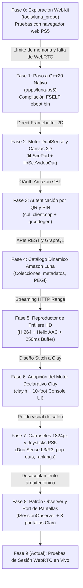

# HISTORIAL Y ROADMAP DEL PROYECTO — AMAZON LUNA PS5

> **Documento de Evolución Histórica y Planificación Futura**  
> Detalla el origen del proyecto, las fases completadas desde el inicio y las tareas pendientes para culminar el cliente nativo.

---

## 1. Evolución Histórica: Del Origen al Estado Actual

### Fase 0: La Génesis — Exploración de WebKit en PS5 (`tools/luna_probe`)
- **Idea Inicial:** Cargar la interfaz web oficial de Amazon Luna (`luna.amazon.es`) dentro del navegador interno de PS5 mediante un bridge local.
- **Lección Aprendida y Bloqueo:** El motor WebKit de PS5 está sumamente restringido en memoria (~200 MB antes de OOM crash), carece de soporte acelerado por hardware para WebRTC DataChannels y no permite mapear los gatillos adaptativos ni la vibración háptica del mando DualSense.
- **Decisión Arquitectónica:** Se descartó el enfoque de navegador web y se migró hacia un **cliente 100% nativo en C++20**.

### Fase 1: Creación del Cliente Nativo C++20 y Toolchain FSELF
- **Implementación:** Creación de `apps/luna-ps5/` con enlace dinámico sobre el runtime oficial de PS5.
- **Cadena de Construcción:** Uso del compilador Clang LLVM PS5 (`C:\llvm-ps5\bin`) y el Payload SDK (`C:\ps5-payload-sdk`).
- **Logro Técnico:** Creación del script [build_ps5.ps1](file:///c:/proyectos%20antigravity/webkit%20PS5%20v2/apps/luna-ps5/build_ps5.ps1), firmando binarios FSELF válidos (`eboot.bin` de Title ID `PPSA99825` y módulo auxiliar `libc.prx`) con 0 llamadas a syscalls directas no permitidas.

### Fase 2: Control DualSense Nativo y Primer Framebuffer 2D
- **Implementación:** Lectura directa del mando mediante la librería del sistema `libScePad` y salida gráfica con `libSceVideoOut` en un framebuffer ARGB a 1920×1080.
- **Logro:** Navegación por menús primitivos con cruceta y botones de acción sin lag de entrada.

### Fase 3: Autenticación Amazon Code-Based Linking (CBL)
- **Implementación:** Se implementó [cbl_client.cpp](file:///c:/proyectos%20antigravity/webkit%20PS5%20v2/apps/luna-ps5/src/auth/cbl_client.cpp) y se integró [qrcodegen.c](file:///c:/proyectos%20antigravity/webkit%20PS5%20v2/apps/luna-ps5/src/util/qrcodegen.c).
- **Logro:** Inicio de sesión instantáneo: el usuario escanea el código QR que se dibuja en la pantalla de su TV o introduce el PIN de 6 caracteres en `amazon.com/code`. Al autorizar, los tokens de acceso y refresco se guardan de forma segura en `account.json` (fichero protegido en `.gitignore`).

### Fase 4: Reverse Engineering y Conexión al Catálogo de Luna
- **Implementación:** Análisis y captura del tráfico de red de Amazon Luna. Se implementaron los parsers de endpoints REST/GraphQL en [luna_session.cpp](file:///c:/proyectos%20antigravity/webkit%20PS5%20v2/apps/luna-ps5/src/session/luna_session.cpp).
- **Logro:** Extracción dinámica del catálogo completo con colecciones oficiales ("Las mejores novedades", "Seguir jugando", "Añadidos recientemente", "Personajes emblemáticos", "Jugad juntos"), carátulas, sinopsis, géneros y clasificación PEGI.

### Fase 5: Reproductor Multimedia de Tráilers HD (`Mp4PreviewPlayer`)
- **Desafío:** Reproducir vídeos MP4 en alta definición dentro de la interfaz sin congelar el hilo principal de renderizado ni agotar la memoria de la consola.
- **Solución:**
  - Streaming HTTP por rangos (`Range: bytes=...`) gestionado por un worker thread asíncrono en un buffer estático de **48 MB**.
  - Decodificación de vídeo H.264 por hardware con `libSceVideodec2`.
  - Decodificación de audio AAC con Helix AAC embebido (arena estática de **128 KB**).
  - Implementación de un pre-buffering de audio de **~250 ms** en `AudioManager` para garantizar reproducción continua sin chasquidos (*pops*) ni desincronización.

### Fase 6: Rediseño Visual en Google Stitch y Adopción de `Clay`
- **Motivación:** El código de dibujado manual 2D se volvía complejo e inflexible para layouts de consola modernos.
- **Solución:** Se prototipó la interfaz completa en **Google Stitch** (`Luna Console OS`), exportándola a HTML y portándola al motor declarativo en C puro **Clay** (`clay.h`).
- **Logro:** Interfaz fluida a 60 FPS con bordes redondeados, degradados bioluminiscentes, auto-layout flexbox y soporte multirresolución.

### Fase 7: Perfeccionamiento Ergonómico y Visual de Salón
- **Mejoras Implementadas:**
  - **Carruseles a borde completo (1824 px):** Tarjetas que aprovechan todo el ancho útil de la pantalla de TV.
  - **Iconos analógicos PS5:** Joysticks L3 y R3 renderizados proceduralmente con pozo concéntrico, cúpula cóncava y muescas de goma táctiles.
  - **Doble comportamiento de entrada:** Desplazamiento horizontal de carruseles mediante el joystick analógico y cambio entre botones de acción del banner mediante la cruceta (D-pad).
  - **Hero dinámico:** La mitad izquierda del banner muestra el backdrop en alta resolución del juego con fundido suave (*Hermite curve*) hacia el tráiler de la derecha.
  - **Banners rotativos:** Fondos automáticos que van alternando las ilustraciones de los juegos de la colección.
  - **Tipografía de rankings:** Números estilizados gigantes (1 al 10) con contorno de alto contraste.
  - **Pop-out Preview Cards:** Tarjetas expandidas que muestran datos reales de Amazon Luna (géneros, desarrollador, métodos de entrada y botón "JUGAR AHORA").

### Fase 8: Desacoplamiento Arquitectónico (Observer) y Port Completo
- **Implementación:** Creación de [ISessionObserver](file:///c:/proyectos%20antigravity/webkit%20PS5%20v2/apps/luna-ps5/src/session/isession_observer.h) para independizar el motor de sesión del motor de UI.
- **Port de Pantallas:** Se completaron y conectaron en [main.cpp](file:///c:/proyectos%20antigravity/webkit%20PS5%20v2/apps/luna-ps5/src/display/luna_clay_ui.cpp) las 8 pantallas: Home, Ficha de Juego, Ajustes, Error, Login CBL, Media Viewer, Streaming HUD y Remote Play.
- **Auditoría Forense:** Purgado total de credenciales del historial de Git, dejando el repositorio 100% limpio y seguro.

---

## 2. Recursos y Tecnologías Utilizados

### A. Servicios y APIs en la Nube
1. **Amazon OAuth CBL:** `api.amazon.com/auth/O2/create/codepair` y `/token` (Autenticación sin teclado en consola).
2. **Amazon Luna APIs:** `luna.amazon.es/api/` y `catalog.luna.amazon.com/` (Catálogo, metadatos y portadas).
3. **CloudFront CDN:** Servidores de alta velocidad de Amazon para tráilers MP4 y assets de juegos.
4. **Amazon Tempo Cloud Engine:** Servidores de streaming interactivo con protocolo WebRTC y señalización SDP/ICE.

### B. Bibliotecas de Código Abierto Embebidas (Sin dependencias externas pesadas)
- **Clay UI (`clay.h`):** Motor de diseño declarativo en C puro con rendimiento ultra-rápido.
- **libdatachannel 0.23.1 + mbedTLS 3.6.2:** Pila de WebRTC nativa en C++ con soporte DTLS-SRTP.
- **libopus:** Decodificador de audio Opus en tiempo real.
- **qrcodegen (`qrcodegen.c`):** Generador de códigos QR vectoriales de alta precisión.
- **stb_truetype:** Renderizador y rasterizador de fuentes TrueType en texturas de memoria.
- **minih264 / Helix AAC:** Motores de decodificación de vídeo y audio ligeros para streaming embebido.

### C. SDK y Librerías del Sistema PS5
- `libkernel.prx` (gestión de hilos, memoria virtual y sincronización).
- `libSceVideoOut.prx` (acceso directo al hardware de pantalla y sincronización VSync).
- `libSceVideodec2.prx` (aceleración de vídeo por hardware).
- `libScePad.prx` (lectura de botones, joysticks y gatillos del mando DualSense).
- `libSceAudioOut.prx` (salida de audio digital PCM multicanal).
- `libSceNet.prx` (pila de sockets BSD para comunicaciones de red).

---

## 3. Lo que nos Queda: Hoja de Ruta Pendiente (Backlog Priorizado)

### 📌 Hito 1: Verificación de Sesión de Juego en Vivo por WebRTC (Alta Prioridad)
- **Objetivo:** Probar el lanzamiento de una sesión real de juego en la nube con una cuenta activa de Amazon Luna en la consola PS5.
- **Tareas:**
  1. Validar el intercambio de la oferta/respuesta SDP y recolección de candidatos ICE con Amazon Tempo.
  2. Verificar la recepción del flujo de paquetes de vídeo RTP y su decodificación directa en pantalla.
  3. Comprobar la respuesta de los comandos del DualSense enviados por el DataChannel a 250 Hz.
  4. Ajustar el jitter buffer de audio Opus para garantizar sonido sin latencia perceptible.

### 📌 Hito 2: Refactorización y Limpieza de `main.cpp` (Media Prioridad)
- **Objetivo:** Trasladar la lógica del bucle principal hacia `src/game/game_loop.cpp` y `src/game/game_state.cpp`.
- **Tareas:**
  1. Implementar la clase singleton `GameState` formalmente para encapsular las variables globales de estado.
  2. Reducir `main.cpp` a un punto de entrada conciso (<300 líneas) que inicialice los subsistemas y delegue en `GameLoop`.
  3. Asegurar que `build_ps5.ps1` y el CMake de escritorio compilen limpiamente con el nuevo diseño.

### 📌 Hito 3: Sub-paneles de Ajustes y Modal de Mandos Bluetooth (Media Prioridad)
- **Objetivo:** Completar la interacción interna de la pantalla de Ajustes.
- **Tareas:**
  1. Cablear el modal de sincronización de mandos Bluetooth adicionales (`drawBluetoothGamepadModal`).
  2. Implementar los selectores de calidad de streaming (720p / 1080p, límite de bitrate de 15 Mbps a 35 Mbps) persistidos en `settings.json`.
  3. Completar el selector de cuentas vinculadas (cambio de perfil o cierre de sesión CBL).

### 📌 Hito 4: Integración del Selector de "Remote Play / Mi Espacio" (Baja Prioridad)
- **Objetivo:** Conectar la pantalla `renderRemotePlayScreen` existente en Clay con el selector de modos del menú superior.
- **Tareas:**
  1. Mostrar los juegos marcados como favoritos y jugados recientemente por el usuario en esta vista dedicada.
  2. Permitir el filtrado rápido de la biblioteca personal.

### 📌 Hito 5: Paquete Final de Distribución LiveArea para PS5 (Cierre)
- **Objetivo:** Preparar el paquete definitivo listo para instalar en cualquier PS5.
- **Tareas:**
  1. Diseñar los assets oficiales de LiveArea: icono de la aplicación (`icon0.png`, 512×512), imagen de fondo de inicio (`pic0.png`, 1920×1080) y splash de arranque.
  2. Generar el `param.json` definitivo con metadatos de categoría, versión y título multilingüe.
  3. Empaquetar y probar la instalación limpia vía Package Installer en la consola.
